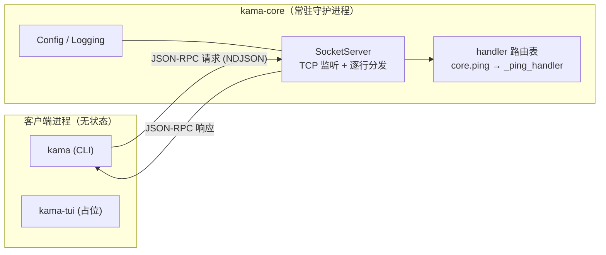
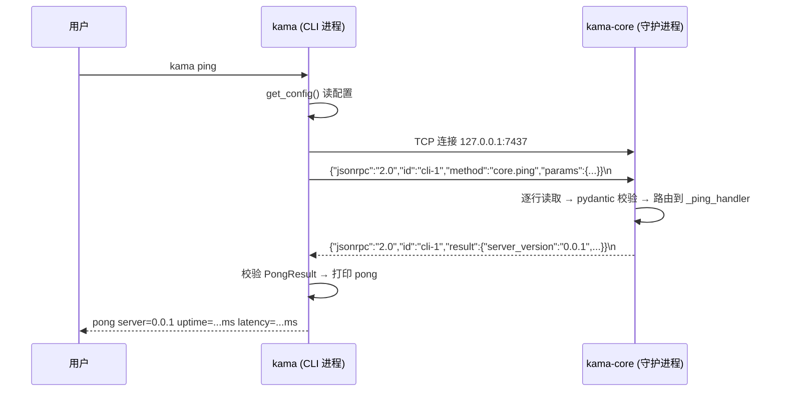

# S0 阶段 · 项目说明（KamaClaude 骨架）

> 本文按《第 0 阶段》大纲逐节展开，对应分支 `stage/s0`，代码位置以 `src/kama_claude/` 为根。

---

## 1. 本阶段要做什么

S0 的目标只有一个：**把"客户端 → 守护进程"这条通信链路完整跑通，但不实现任何业务**。

具体交付物：

| 交付物 | 说明 |
|---|---|
| 双进程 IPC 骨架 | CLI 客户端 + TCP 守护进程，JSON-RPC 2.0 / NDJSON 协议 |
| `core.ping` 命令 | 唯一的端点，兼作未来所有命令的**样板** |
| 四层配置体系 | 内建默认值 → TOML → `.env` → 环境变量 |
| 结构化日志 | text/json 两种格式 + 滚动文件 |
| 协议文档自动生成 | `WIRE_PROTOCOL.md` 由 pydantic 模型生成，CI 校验同源 |

**明确不做的**：Agent 逻辑、LLM 调用、TUI、事件推送——这些留给 S1+。S0 阶段的 `ping/pong` 是"心跳"，用来验证插座通电，而不是电器本身。

---

## 2. 先看两个进程怎么摆

系统是**双进程模型**：客户端无状态、随开随关；守护进程常驻、持有全部状态。





三个可执行入口在 `pyproject.toml` 中声明：

```toml
[project.scripts]
kama      = "kama_claude.cli.main:main"        # 客户端
kama-core = "kama_claude.core.app:run"         # 守护进程
kama-tui  = "kama_claude.tui.__main__:main"    # 占位（S2）
```

---

## 3. 项目先能被正确 import

采用 **src 布局**：源码不放在仓库根，而是 `src/kama_claude/`，由 Hatch 在打包时收录：

```toml
[tool.hatch.build.targets.wheel]
packages = ["src/kama_claude"]
```

src 布局的好处：**测试和脚本只能 import "已安装"的包**，杜绝"本地能跑、装完就坏"的隐性路径问题。

包的最小结构（S0 全景）：

```
src/kama_claude/
├── __init__.py          # 仅一行：__version__ = "0.0.1"
├── core/                # ★ 守护进程侧
│   ├── __main__.py      # python -m kama_claude.core → run()
│   ├── app.py           # CoreApp：编排配置/日志/服务器/信号
│   ├── config.py        # 四层配置
│   ├── logging_setup.py # 日志初始化
│   ├── bus/             # 协议层（契约边界）
│   │   ├── envelope.py  # JSON-RPC 信封 + 错误码
│   │   ├── commands.py  # 请求模型（PingCommand / PongResult）
│   │   └── events.py    # 事件模型（CoreStartedEvent，预留）
│   └── transport/
│       └── socket_server.py  # TCP 收发与分发
├── cli/                 # ★ 客户端侧
│   ├── main.py          # argparse 分发
│   └── commands/{ping,version}.py
└── tui/__main__.py      # 占位
```

能被正确 import 的验证点：

```bash
uv sync                      # 安装为可编辑包
uv run kama --version        # → 0.0.1（cli/commands/version.py 读取 __init__.__version__）
uv run python -m kama_claude.core   # 等价于 kama-core
```

版本号只在 `src/kama_claude/__init__.py` 定义一次，其余地方一律 `import kama_claude` 后引用 `kama_claude.__version__`（见 `app.py:29`、`ping.py:32`），避免多处维护。

---

## 4. CLI 入口先读配置

`kama` 的入口是 `cli/main.py:main()`：argparse 解析 → 分发。注意**配置在子命令里读，而不是全局读**——`--version` 不需要碰任何文件：

```python
# cli/main.py:13
def main() -> None:
    parser = argparse.ArgumentParser(prog="kama", description="KamaClaude CLI")
    parser.add_argument("--version", action="store_true")
    subparsers = parser.add_subparsers(dest="command")
    subparsers.add_parser("ping", help="Ping the core daemon")

    args = parser.parse_args()

    if args.version:
        cmd_version()
        return
    if args.command == "ping":
        config = get_config()      # ← 先读配置
        setup_logging(config)      # ← 再初始化日志
        cmd_ping(config)           # ← 最后执行子命令
```

`core/config.py` 实现四层优先级（后者覆盖前者）：

```
内建默认值 → ~/.kama/config.toml → .env → 系统环境变量 (KAMA_*)
```

```python
# core/config.py:41
def get_config() -> KamaConfig:
    config = KamaConfig()
    load_dotenv(".env", override=False)                  # .env 先加载，
    config_path = Path(os.environ.get("KAMA_CONFIG",     # 这样 .env 里的 KAMA_CONFIG
        _DEFAULT_CONFIG_PATH)).expanduser()              # 才能影响 TOML 路径
    ...
    _apply_toml(config, data)
    _apply_env(config)
    return config
```

两个刻意的设计：

1. **fail-fast**：未知 TOML key、类型错误直接 `SystemExit`，绝不静默忽略——错误配置宁可启动失败，也不能带着歧义跑起来（`_apply_toml`，`config.py:63`）。
2. **`.env` 先于 `KAMA_CONFIG` 加载**：顺序反了的话，`.env` 里写的 `KAMA_CONFIG=...` 就永远不生效（`config.py:44-46` 注释明确说明了这一点）。

S0 只认 `core.host / core.port` 与 `logging.{level,file,format}`，配置模型用 dataclass 表达：

```python
@dataclass
class KamaConfig:
    host: str = "127.0.0.1"
    port: int = 7437
    logging: LoggingConfig = field(default_factory=LoggingConfig)
```

日志由 `core/logging_setup.py` 消费配置：stderr handler + 可选的 10MB×5 滚动文件 handler，text/json 两种格式共用一套字段（`level/ts/source/msg`）。

---

## 5. CLI 把 ping 变成一行 JSON

客户端不做任何封装层的花活，就是手工拼一个 JSON-RPC 字典、加换行、写 socket：

```python
# cli/commands/ping.py:24
async def _ping(config: KamaConfig) -> None:
    t0 = time.monotonic()
    reader, writer = await asyncio.open_connection(config.host, config.port)

    req = {
        "jsonrpc": "2.0",
        "id": "cli-1",
        "method": "core.ping",
        "params": {"client": f"cli/{kama_claude.__version__}"},
    }
    writer.write((json.dumps(req) + "\n").encode())   # ← 一行 JSON + \n 就是"一帧"
    await writer.drain()

    line = await asyncio.wait_for(reader.readline(), timeout=10.0)
    latency_ms = int((time.monotonic() - t0) * 1000)
    ...
```

要点：

- **NDJSON 帧协议**：一条消息 = 一行 JSON = 一个 `\n`。`readline()` 天然按帧切分，不需要长度前缀。
- **延迟从连接前开始计时**（`t0` 在 `open_connection` 之前），所以打印出来的 latency 是"连接 + 往返"的全链路耗时。
- **`id: "cli-1"`**：JSON-RPC 要求响应携带与请求相同的 id，客户端靠它配对（S0 单请求无所谓，S1+ 并发时是关键）。
- 连不上时 `cmd_ping` 捕获 `ConnectionRefusedError`，打印 `error: core not running (host:port)` 并 `exit(1)`（`ping.py:15-20`）。

---

## 6. 协议模型先挡住坏消息

`core/bus/` 是**契约边界**：所有跨进程消息都是 pydantic v2 模型，坏消息在进入业务代码前就被拦截。

### 6.1 信封层 `envelope.py`

JSON-RPC 2.0 的四种信封 + 五个标准错误码：

```python
class JsonRpcRequest(BaseModel):
    jsonrpc: Literal["2.0"] = "2.0"   # ← Literal：jsonrpc 字段不是 "2.0" 直接校验失败
    id: str
    method: str
    params: dict[str, Any] = Field(default_factory=dict)

class JsonRpcSuccess(BaseModel):
    jsonrpc: Literal["2.0"] = "2.0"
    id: str
    result: Any

PARSE_ERROR      = -32700   # 不是合法 JSON
INVALID_REQUEST  = -32600   # 缺 jsonrpc/id/method 等必需字段
METHOD_NOT_FOUND = -32601   # 路由表里没有这个 method
INVALID_PARAMS   = -32602   # handler 校验 params 失败
INTERNAL_ERROR   = -32603   # handler 抛了未捕获异常
```

### 6.2 命令层 `commands.py`：判别联合

用 `type` 字段做判别式，未来加命令 = 加一个类 + 往 `Command` 联合里加一项：

```python
class PingCommand(BaseModel):
    type: Literal["core.ping"] = "core.ping"
    client: str

class PongResult(BaseModel):
    server_version: str
    uptime_ms: int
    received_at: str  # ISO 8601

Command = Annotated[PingCommand, Discriminator("type")]
```

### 6.3 校验发生在哪

坏消息在 `socket_server.py:_handle_line` 的四个关卡被逐级拦截，每一级对应一个标准错误码：

| 关卡 | 坏消息 | 返回 |
|---|---|---|
| `json.loads` 失败 | 不是 JSON | `-32700 Parse error` |
| `JsonRpcRequest.model_validate` 失败 | JSON 合法但信封缺字段 | `-32600 Invalid Request` |
| `handlers.get(method)` 落空 | 方法不存在 | `-32601 Method not found` |
| handler 内 `ValidationError` | params 类型不对 | `-32602 Invalid params` |
| 其他异常 | 业务代码 bug | `-32603 Internal error`（`logger.exception` 记录堆栈） |

**设计意图**：协议正确性由类型系统保证，业务代码永远只面对"已校验通过"的输入。

---

## 7. daemon 监听 TCP 并逐行处理

### 7.1 传输层 `transport/socket_server.py`

`SocketServer` 只管收发和分发，不懂任何业务：

```python
class SocketServer:
    def __init__(self, host: str, port: int) -> None:
        self._handlers: dict[str, CommandHandler] = {}   # 路由表

    def register(self, method: str, handler: CommandHandler) -> None:
        self._handlers[method] = handler                 # 命令路由：method 名 → 处理函数
```

启动时的**单实例保证**很取巧——先试着连一下目标端口，能连上说明已有 daemon 在跑，直接退出：

```python
# socket_server.py:40
async def start(self) -> str:
    try:
        _r, w = await asyncio.open_connection(self._host, self._port)  # 探活
        w.close(); await w.wait_closed()
        raise SystemExit(f"core already running at {self._host}:{self._port}")
    except (ConnectionRefusedError, OSError):
        pass                                             # 连不上 → 端口空闲，继续
    self._server = await asyncio.start_server(self._handle_connection, ...)
```

连接处理是三层递进（`socket_server.py:65-136`）：

```
_handle_connection   # 一条 TCP 连接：记 peer 日志，finally 里保证关流
  └─ _read_loop      # while True: readline() → 逐帧分发；readline() 返回空 = 对端关连接
       └─ _handle_line  # 一帧：loads → 校验 → 查路由 → await handler → 写回
```

帧上限 1MB（`limit=_MAX_LINE_BYTES`），超限返回 `INVALID_REQUEST`。

### 7.2 应用层 `core/app.py`

`CoreApp.run()` 是唯一的异步编排入口，按固定顺序装配：

```python
# core/app.py:35
async def run(self) -> None:
    self._start_time = time.monotonic()
    config = get_config()                                # 1. 配置
    setup_logging(config)                                # 2. 日志
    server = SocketServer(config.host, config.port)
    server.register("core.ping", self._ping_handler)     # 3. 注册路由
    addr = await server.start()                          # 4. 监听
    logger.info("kama-core %s listening addr=%s", ...)
    ...
    await shutdown.wait()                                # 5. 阻塞等 SIGINT/SIGTERM
    await server.stop()                                  # 6. 优雅关闭（最多等 2s）
```

信号处理做了跨平台兼容：Unix 用 `loop.add_signal_handler`，Windows 上该方法未实现（`NotImplementedError`），退回 `signal.signal` + `loop.call_soon_threadsafe(shutdown.set)`，保证 Ctrl+C 同样能优雅退出（`app.py:49-60`）。

---

## 8. 一行请求如何变成 PongResult

这是 S0 唯一的"业务"，也 future 功能的模板——handler 收到的 `params` 是**未经校验的 dict**，返回的是**pydantic 模型**：

```python
# core/app.py:25
async def _ping_handler(self, params: dict[str, Any]) -> PongResult:
    client = params.get("client", "unknown")
    logger.debug("ping from %s", client)
    return PongResult(
        server_version=kama_claude.__version__,                  # 包版本，单点来源
        uptime_ms=int((time.monotonic() - self._start_time) * 1000),
        received_at=datetime.datetime.now(datetime.UTC).isoformat(),
    )
```

序列化回线格式由 `socket_server.py:135-136` 统一完成：

```python
result_data = result.model_dump() if isinstance(result, BaseModel) else result
await self._send(writer, JsonRpcSuccess(id=req.id, result=result_data))
```

细节值得注意：

- **`time.monotonic()` 而不是墙钟**：算 uptime 不能用可能被 NTP 调整的系统时间。
- **`_start_time` 在 `run()` 开头重置**：`__init__` 里的赋值只是兜底，真实计时从进程事件循环启动开始。
- handler 返回模型、传输层负责 dump——业务代码完全不感知 JSON。

一次完整的数据变换链：

```
bytes(b'{"jsonrpc":"2.0",...}\n')
  → dict            (json.loads)
  → JsonRpcRequest  (pydantic 校验信封)
  → handler(params: dict)
  → PongResult      (pydantic 模型)
  → dict            (model_dump)
  → JsonRpcSuccess  (包信封)
  → bytes           (model_dump_json + b"\n")
```

---

## 9. CLI 解析响应并打印结果

客户端侧是镜像操作：收一行 → 拆信封 → 校验 payload → 打印：

```python
# cli/commands/ping.py:43
raw = json.loads(line)
if "error" in raw:                                   # 错误响应 → 打 code+message，exit(1)
    err = JsonRpcError.model_validate(raw)
    print(f"error: {err.error.code} {err.error.message}", file=sys.stderr)
    sys.exit(1)

resp = JsonRpcSuccess.model_validate(raw)            # 成功 → 校验信封
result = PongResult.model_validate(resp.result)      # 再校验 payload 结构
print(f"pong server={result.server_version} uptime={result.uptime_ms}ms latency={latency_ms}ms")
```

注意客户端**不复用**服务端的 `_handle_line` 那套分发逻辑——它只关心"我发的那条请求的响应"，用 `"error" in raw` 做最朴素的成功/失败分支。对 S0 足够；等 S1 引入并发请求和事件推送后，这里会演进成真正的响应多路分解器。

`10s` 超时（`ping.py:37`）保证 daemon 假死时客户端不会永久挂起。

---

## 10. 协议文档从模型生成

`WIRE_PROTOCOL.md` **不是手写的**，由 `scripts/gen_protocol_doc.py` 从 pydantic 模型生成：

```python
# scripts/gen_protocol_doc.py:16
def _model_section(name, model, example=None) -> str:
    schema = model.model_json_schema()      # ← 文档来源就是模型本身
    ...                                     # 生成字段表格 + JSON Schema + 示例
```

生成内容：Transport 说明 → Commands（PingCommand/PongResult 的字段表、Schema、示例）→ Events → Error Codes 表。

关键机制是 `--check` 模式——**CI 用来校验"文档与代码同源"**：

```python
if output_path.read_text() != content:
    print("ERROR: ... out of sync with code — run: make docs", file=sys.stderr)
    sys.exit(1)
```

工作流：

```
改了 bus/ 下的模型
  → uv run python scripts/gen_protocol_doc.py   # 重新生成 WIRE_PROTOCOL.md
  → 与代码一起提交
CI 跑 --check，不同步则红
```

这杜绝了"协议改了、文档忘了改"的经典腐化路径：**模型是唯一事实源，文档只是它的投影**。

---

## 11. 小结与展望

### S0 立住了什么

| 层 | 位置 | 职责 | 关键设计 |
|---|---|---|---|
| 配置 | `core/config.py` | 四层合并 | fail-fast；`.env` 先于 `KAMA_CONFIG` |
| 日志 | `core/logging_setup.py` | stderr + 滚动文件 | text/json 双格式 |
| 协议 | `core/bus/` | 信封 + 命令/事件模型 | pydantic 判别联合；错误码标准化 |
| 传输 | `core/transport/socket_server.py` | TCP/NDJSON 收发 | 路由表分发；探活保证单实例；五级错误拦截 |
| 编排 | `core/app.py` | 装配 + 优雅退出 | 信号 → Event → `server.stop()` |
| 客户端 | `cli/` | 拼请求 / 解响应 | 与服务端共享同一套模型 |

一句话：**S0 修好了"插座和电线"**——客户端连守护进程、发命令、收响应的整条链路类型安全地跑通，墙上还没插电器。

### 后续阶段怎么在这块地基上盖楼

- **加一个新命令的标准动作**（三步）：
  1. `bus/commands.py` 加请求/响应模型 + 加入 `Command` 判别联合；
  2. `app.py` 写 handler 并 `server.register("xxx.yyy", ...)`；
  3. `cli/commands/` 加客户端子命令；最后 `make docs` 重新生成协议文档。
- **S1+（Agent 能力）**：`runs.py`（占位中）将用于记录 Agent 运行事件；`bus/events.py` 的 `CoreStartedEvent` 已为"服务端主动推送"预留了通道——JSON-RPC 响应之外的第二种帧类型。
- **S2（TUI）**：`kama-tui` 接入同一套协议，客户端可多开而状态只在 daemon。

### 已知的边界（S0 有意为之）

- 请求/响应严格一问一答，无并发请求流水线、无事件推送实现。
- 客户端不做响应多路分解（单请求场景够用）。
- 探活与监听之间存在极小的 TOCTOU 窗口（两个 daemon 同时启动的理论竞态）——单机单用户场景可接受，多实例需求出现时换文件锁/pid 文件方案。
