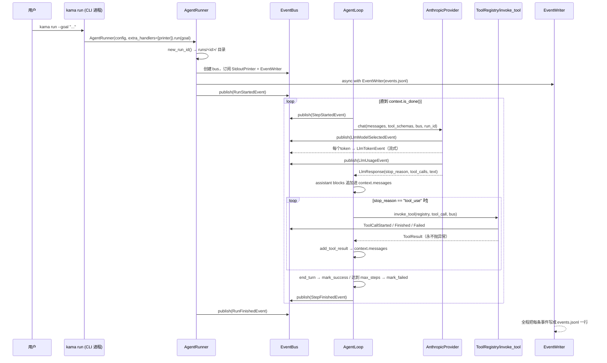

# S1 阶段 · 项目说明（Agent 第一次运行）

> 本文按《第 1 阶段：Agent 第一次运行》大纲逐节展开，对应分支 `stage/s1`，代码位置以 `src/kama_claude/` 为根。S0 的 IPC 骨架（配置/日志/协议层）全部复用，不再重复。

---

## 1. 本阶段要做什么

S0 只有"心跳"，S1 让系统第一次**真正做事**：`kama run --goal "..."` 启动一个 Agent，它调用 LLM、按需使用工具、循环迭代直到完成目标。

| 交付物 | 说明 |
|---|---|
| `kama run --goal` 命令 | Agent 的 CLI 入口 |
| AgentLoop | plan → act → observe 的主循环 |
| AnthropicProvider | 流式调用 LLM（含 prompt caching） |
| 工具系统 | `BaseTool` 抽象 + 注册表 + 安全调用包装，内置 `read_file` |
| EventBus + 事件模型 | 11 种运行事件，订阅者解耦 |
| ExecutionContext | 单次运行的状态与消息历史 |
| EventWriter | 每次运行落盘 `runs/<run_id>/events.jsonl` |
| StdoutPrinter | 终端实时输出（token 级流式） |

**一个关键的架构决策**：S1 的 Agent **运行在 CLI 进程内**，不经过 `kama-core` 守护进程——`cmd_run` 直接在进程内组装 `AgentRunner`。S0 的 daemon 仍然在、`ping` 仍然通，但 `run` 走的是最短路径。理由：第一次跑通 Agent，先把"LLM ↔ 工具 ↔ 事件"这条内环做对；daemon 化（远程提交 run、TUI 订阅事件）留给后续阶段。

**新增依赖**：`anthropic>=0.25`（流式 + prompt caching SDK）。配置新增 `[agent].max_steps`（默认 20）与 `[llm].default_model`（默认 `claude-sonnet-4-6`）、`[llm].router`（S1 固定 `static`）。

---

## 2. 设计：顺着执行流走一遍

从用户敲下命令到终端打印完成，整条链路如下：



设计上的三条主线：

1. **依赖倒置**：`AgentLoop` 只认识 `LLMProvider` Protocol 和 `ToolRegistry`，不认识 Anthropic SDK——测试时可注入假的 provider。
2. **事件驱动解耦**：循环里只管 `bus.publish(...)`，"打印到终端"和"落盘 JSONL"都是订阅者，互不知晓对方存在。
3. **错误降级不升级**：工具报错变成 `is_error` 的 tool_result 继续对话（LLM 可以自我纠正）；只有 LLM API 本身挂掉才终止整个 run。

---

## 3. 实现

### 3.1 命令入口

`cli/main.py` 注册 `run` 子命令，`--goal` 必填：

```python
run_parser = subparsers.add_parser("run", help="Run an agent task")
run_parser.add_argument("--goal", required=True, help="Goal for the agent to accomplish")
...
elif args.command == "run":
    cmd_run(args.goal, config)
```

`cli/commands/run.py` 的入口短得刻意——它只做两件事：造 Printer、造 Runner、跑：

```python
def cmd_run(goal: str, config: KamaConfig) -> None:
    printer = StdoutPrinter()
    runner = AgentRunner(config, extra_handlers=[printer.handle])
    try:
        asyncio.run(runner.run(goal))
    except KeyboardInterrupt:
        sys.exit(130)        # 130 = 128 + SIGINT(2)，符合 shell 惯例
```

### 3.2 AgentRunner 把所有零件组装起来

`core/runner.py` 是**组合根（composition root）**：所有依赖在这里接线，其他类只管干活。构造函数允许注入覆盖，为测试留缝：

```python
class AgentRunner:
    def __init__(self, config, *, provider=None, extra_handlers=None, runs_dir=None):
        self._provider = provider          # None → 用真 AnthropicProvider
        self._runs_dir = runs_dir or RUNS_DIR   # 测试时指到 tmp_path
```

`run()` 的装配顺序就是一幕"接线图"：

```python
async def run(self, goal: str) -> None:
    run_id = new_run_id()                       # YYYYMMDD-HHMMSS-xxxxxx
    run_path = self._runs_dir / run_id
    run_path.mkdir(parents=True, exist_ok=True)

    bus = EventBus()                            # 1. 事件总线
    for h in self._extra_handlers:
        bus.subscribe(h)                        #    （CLI 传入的 StdoutPrinter）

    provider = self._provider or AnthropicProvider(self._config.llm.default_model)
    registry = ToolRegistry()
    registry.register(ReadFileTool())           # 2. S1 唯一内置工具
    loop = AgentLoop(provider, registry, bus)

    context = ExecutionContext(run_id=run_id, goal=goal,
                               max_steps=self._config.agent.max_steps)

    async with EventWriter(run_path / "events.jsonl") as writer:
        writer.subscribe(bus)                   # 3. 落盘订阅者
        await bus.publish(RunStartedEvent(...))
        try:
            await loop.run(context)             # 4. 主循环
        except asyncio.CancelledError:
            cancelled = True
            if not context.is_done():
                context.mark_failed("cancelled")
        await bus.publish(RunFinishedEvent(...))
    if cancelled:
        raise asyncio.CancelledError()          # 尊重外层的取消语义
```

`run_id` 由 `core/runs.py` 生成：时间戳 + 6 位 uuid 后缀（`20261018-143022-a1b2c3`），既可排序又防碰撞。S0 里占位的 `runs.py` 在这里正式启用。

### 3.3 EventBus——让所有人都能听到

`core/events/bus.py` 只有 15 行，但它是整个阶段解耦的关键：

```python
type EventHandler = Callable[[BaseModel], Awaitable[None]]

class EventBus:
    def __init__(self) -> None:
        self._subscribers: list[EventHandler] = []

    def subscribe(self, handler: EventHandler) -> None:
        self._subscribers.append(handler)

    async def publish(self, event: BaseModel) -> None:
        for handler in self._subscribers:
            await handler(event)      # 按注册顺序同步 await —— 事件顺序有保证
```

设计取舍：**publish 逐个 await 订阅者**而不是 `asyncio.gather`/后台队列——换来的是"事件的消费顺序 == 发布顺序"这个强保证，S1 只有一个慢消费者（终端打印），简单正确优先于吞吐。

订阅者有两类：

- **`EventWriter`**（`core/events/writer.py`）：把每条事件 `model_dump_json()` 写成 `events.jsonl` 的一行并 flush；写失败只记日志不抛异常——**观测系统的故障不能杀死业务运行**。`async with` 管理文件生命周期。
- **`StdoutPrinter`**（见 §3.9）。

事件模型全部定义在 `core/bus/events.py`（S0 的判别联合模式扩展到 11 种，全部携带 `run_id` 和 ISO 时间戳）：

| 事件 | 发布者 | 意义 |
|---|---|---|
| `run.started` / `run.finished` | AgentRunner | 一次运行的边界 |
| `step.started` / `step.finished` | AgentLoop | 一次 plan-act-observe 迭代 |
| `tool.call_started` / `call_finished` / `call_failed` | invoke_tool | 工具执行三态 |
| `llm.model_selected` / `llm.token` / `llm.usage` | AnthropicProvider | 模型选择、token 流、用量（含 cache 统计） |
| `log.line` | （预留） | 结构化日志事件 |
| `core.started` | S0 daemon | 心跳阶段遗留 |

### 3.4 ExecutionContext —— Agent 的记忆

`core/context.py` 是一个纯数据类，承载一次 run 的全部状态：

```python
@dataclass
class ExecutionContext:
    run_id: str
    goal: str
    max_steps: int
    messages: list[dict[str, Any]] = field(default_factory=list)  # 对话历史
    step: int = 0
    status: str = "running"     # "running" | "success" | "failed"
    reason: str | None = None
```

三个值得说的方法：

**① goal 自动成为首条用户消息**（`__post_init__`）：

```python
def __post_init__(self) -> None:
    if not self.messages:
        self.messages.append({"role": "user", "content": self.goal})
```

**② 工具结果合并规则**——Anthropic API 要求"同一条 assistant 消息里的多个 tool_use，其结果必须在同一条 user 消息里"。`add_tool_result` 实现了这个合并：若最后一条已是"纯 tool_result 的 user 消息"就追加 block，否则新建：

```python
last = self.messages[-1] if self.messages else None
if (last is not None and last["role"] == "user"
        and isinstance(last["content"], list)
        and all(b.get("type") == "tool_result" for b in last["content"])):
    last["content"].append(block)     # 同步的多个工具结果共享一条 user 消息
else:
    self.messages.append({"role": "user", "content": [block]})
```

**③ 状态机**：`mark_success()` / `mark_failed(reason)` 只能从 `running` 迁移出去，`is_done()` 就是循环的停止条件。`reason` 的取值约定：`"exceeded_max_steps"` / `"cancelled"` / `"llm_error"`。

### 3.5 AgentLoop

`core/loop.py` 是整个 Agent 的心脏——一个 while 循环，每轮四拍：**plan → observe → act → 终止判定**。

```python
async def run(self, context: ExecutionContext) -> None:
    while not context.is_done():
        context.step += 1
        await self._bus.publish(StepStartedEvent(...))

        # [plan] 调 LLM —— API 错误终止整个 run
        try:
            response = await self._provider.chat(
                messages=context.messages,
                tool_schemas=self._registry.tool_schemas(),
                bus=self._bus, run_id=context.run_id)
        except asyncio.CancelledError:
            context.mark_failed("cancelled"); raise
        except Exception:
            context.mark_failed("llm_error"); break

        # [observe] 把 assistant 响应写回历史（text block + tool_use blocks）
        blocks = []
        if response.text:
            blocks.append({"type": "text", "text": response.text})
        for tc in response.tool_calls:
            blocks.append({"type": "tool_use", "id": tc.id,
                           "name": tc.name, "input": tc.input})
        context.add_assistant_message(blocks)

        # [act] 逐个执行工具；工具错误变成 tool_result，循环继续
        if response.stop_reason == "tool_use":
            for tc in response.tool_calls:
                result = await invoke_tool(self._registry, tc, self._bus, context.run_id)
                context.add_tool_result(tc.id, result.content, is_error=result.is_error)

        # 终止判定：end_turn 优先于 max_steps（同一步同时触发时）
        if response.stop_reason == "end_turn":
            context.mark_success()
        elif context.step >= context.max_steps:
            context.mark_failed("exceeded_max_steps")

        await self._bus.publish(StepFinishedEvent(...))
```

两个细节体现错误处理的分级哲学：

- **工具错误 ≠ 运行失败**：`invoke_tool` 永不抛异常，错误作为 `is_error=True` 的 tool_result 回给 LLM，模型下一轮有机会自我纠正。
- **LLM API 错误 = 运行失败**：provider 挂了没有"下一轮"可言，直接 `mark_failed("llm_error")` 退出。`CancelledError` 特殊处理：标记后**继续向上抛**，让 runner 和 asyncio 都能感知取消。

### 3.6 AnthropicProvider —— 和 LLM 对话

`core/llm/` 三件套：

**`base.py` — 结构化鸭子类型**。用 `Protocol` 而不是 ABC 做接口，provider 无需继承任何类即可被接受：

```python
class LLMProvider(Protocol):
    async def chat(self, messages, tool_schemas, bus, run_id) -> LlmResponse: ...
```

**`types.py` — 中立的数据类型**。provider 输出的不是 Anthropic SDK 对象，而是自己的 dataclass，下游（loop）完全不感知 Anthropic 的存在：

```python
@dataclass
class LlmResponse:
    stop_reason: str                        # "end_turn" | "tool_use"
    tool_calls: list[ToolCallBlock] = ...
    text: str = ""
    usage: UsageStats | None = None         # 含 cache_read / cache_creation 计数
```

**`provider.py` — 流式 + prompt caching**。三个要点：

1. **流式输出**：`messages.stream()` 逐 token 迭代，每个 token 发一条 `LlmTokenEvent`，最后 `get_final_message()` 拿完整响应：
   ```python
   async with self._client.messages.stream(**kwargs) as stream:
       async for text in stream.text_stream:
           await bus.publish(LlmTokenEvent(run_id=run_id, token=text, ts=_now()))
       final_message = await stream.get_final_message()
   ```
2. **Prompt caching**：system prompt 和**最后一个工具**的 schema 打上 `cache_control: ephemeral`——多轮循环中这两块内容不变，命中缓存可大幅降低输入成本（usage 里的 `cache_read_input_tokens` 可验证）：
   ```python
   system = [{"type": "text", "text": _SYSTEM_PROMPT,
              "cache_control": {"type": "ephemeral"}}]
   if tools:                                  # 只给最后一个工具打标
       last = dict(tools[-1]); last["cache_control"] = {"type": "ephemeral"}
       tools = tools[:-1] + [last]
   ```
3. **模型选择事件**：调用前先发 `LlmModelSelectedEvent(strategy="static")`——S1 是写死的静态路由，但事件字段里已经为 S4（rule_based）/ S6（cost_budget）留好了口子。

另外，构造函数支持注入 `client`，单测可以塞假客户端跳过 API key 检查；未注入且缺 `ANTHROPIC_API_KEY` 时直接 `SystemExit`（fail-fast，与 S0 配置层的哲学一致）。

### 3.7 工具系统 —— 执行 LLM 的请求

四个文件，职责分明：

**`base.py` — 抽象**。每个工具 = 名字 + 描述 + JSON Schema + 一个异步 `invoke`：

```python
@dataclass
class ToolResult:
    content: str
    is_error: bool = False
    error_type: str | None = None   # "runtime_error" | "timeout" | "schema_error"

class BaseTool(ABC):
    name: str
    description: str
    input_schema: dict[str, object]

    @abstractmethod
    async def invoke(self, params: dict[str, object]) -> ToolResult: ...
```

**`registry.py` — 注册表**。`register`（同名覆盖）/ `get` / `tool_schemas()`——最后者把工具翻译成 Anthropic 的 `tools` 参数格式。

**`invocation.py` — 安全调用包装**。LLM 输出的工具调用**不可信**，`invoke_tool` 在真正执行前设了多道闸：

```python
async def invoke_tool(registry, tool_call, bus, run_id, timeout=10.0) -> ToolResult:
    # 1. 发 ToolCallStartedEvent
    # 2. 闸一：工具是否存在      → unknown tool
    # 3. 闸二：required 参数齐不齐 → schema_error: missing required parameters
    # 4. 闸三：asyncio.wait_for 10s 超时 → timeout
    # 5. 闸四：任何异常 → runtime_error
    # 6. 工具自己返回 is_error=True 也走 _fail（发 ToolCallFailedEvent）
    # 7. 全部通过 → ToolCallFinishedEvent + 原样返回 ToolResult
```

核心不变式：**这个函数永远不抛异常**——所有失败都转化为 `ToolCallFailedEvent` + `is_error=True` 的 ToolResult，让主循环稳定继续。

**`builtin/read_file.py` — 第一个真工具**。能力克制、防护到位：

```python
_MAX_BYTES = 512 * 1024

async def invoke(self, params):
    path_str = str(params["path"])
    if ".." in Path(path_str).parts:                  # 禁止路径穿越
        raise PermissionError(f"path traversal not allowed: {path_str}")
    raw = path.read_bytes()                           # 不存在 → FileNotFoundError → 闸四兜底
    truncated = len(raw) > _MAX_BYTES                 # 512KB 截断 + [truncated] 标记
    text = raw[:_MAX_BYTES].decode("utf-8", errors="replace")
    return ToolResult(content=text + ("\n[truncated]" if truncated else ""))
```

**加一个新工具的标准动作**：写一个 `BaseTool` 子类（name/description/input_schema/invoke）→ 在 runner 的装配处 `registry.register(XxxTool())`。schema 自动进 LLM 的 tools 列表，事件与超时保护自动生效。

### 3.8 回到 AgentRunner：收尾工作

循环结束后（无论成功失败），`runner.run()` 还有三件事：

1. **发布 `RunFinishedEvent`**：携带 `status` / `reason` / `steps`——事件流的最后一条，消费方靠它判定整个 run 的结局。
2. **`async with` 退出**：`EventWriter` 关闭文件句柄，`events.jsonl` 完整落盘。
3. **取消语义透传**：如果 run 是被取消的（Ctrl+C / 上层 task.cancel()），标记失败后**重新抛出** `CancelledError`，让 `asyncio.run` 的取消协议不被吞掉。CLI 层把它翻译成 `exit(130)`。

### 3.9 StdoutPrinter：终端的实时输出

`StdoutPrinter`（在 `cli/commands/run.py`）是"用事件流渲染终端 UI"的第一个样本——它只订阅、不参与业务。每种事件一种渲染：

```
[run] 20261018-143022-a1b2c3
[step 1] planning...
I'll read the file to find the magic number.     ← LlmTokenEvent 逐字符打印（end="" + flush）
[tool] read_file {"path": "sample.txt"}          ← ToolCallStarted
[tool] read_file ✓  3ms                          ← ToolCallFinished
[step 1] done
[step 2] planning...
The magic number is 7391.
[step 2] done
[run] success  2 steps  4.7s
```

一个容易被忽略的渲染细节——**`_inline` 状态机**：token 是流式打到行中间的，之后的任何事件都要先补一个换行，否则 `[tool]` 会黏在半句话后面：

```python
def _ensure_newline(self) -> None:
    if self._inline:
        print()
        self._inline = False
```

工具失败走 stderr 并显示 ✗ 与错误信息；`RunFinishedEvent` 打印总耗时（自己记 `time.monotonic()` 起点，不信任事件里的 ts 字段）。

---

## 4. 验证

### 4.1 手动运行

```bash
# 0. 准备密钥
cp .env.example .env        # 然后填 ANTHROPIC_API_KEY=sk-ant-...

# 1. 跑一个真实目标
uv run kama run --goal "读取 README.md 的前 10 行并总结"
# 终端出现 [run]/[step]/[tool]/token 流，最后 [run] success N steps ...s

# 2. 检查落盘的事件流（每次 run 一个目录）
cat runs/<run_id>/events.jsonl | uv run python -m json.tool --json-lines
# 第一行 run.started，最后一行 run.finished，中间是完整的事件轨迹

# 3. S0 回归：心跳不受影响
uv run kama-core &          # 守护进程
uv run kama ping            # → pong server=0.0.1 ...
```

### 4.2 自动化测试

- **单元测试**（13 个文件，不需要网络）：provider 用假 client、loop 用假 provider 驱动多轮工具调用、context 验证 tool_result 合并规则、invocation 验证四道闸、bus/writer 验证订阅与落盘。
- **端到端测试**（`tests/integration/test_run_e2e.py`）：**真实调用 Anthropic API**，断言事件序列与业务结果：

```python
runner = AgentRunner(config, runs_dir=runs_dir)
await runner.run(goal)                      # "读 sample.txt 报告 magic number"

events = [json.loads(l) for l in ...]       # 读 events.jsonl
assert types[0] == "run.started"            # 事件流首尾正确
assert types[-1] == "run.finished"
assert finished["status"] == "success"      # run 成功
assert any(e["tool_name"] == "read_file" ...)  # 工具真的被调用过
assert all(e["run_id"] == run_id for e in events)   # run_id 全程一致
```

无 `ANTHROPIC_API_KEY` 时自动 skip，CI 环境安全。

```bash
uv run pytest tests/unit -v                        # 全量单测，无网络依赖
uv run pytest -m integration -v                    # 端到端（需密钥）
```

---

## 5. 小结与展望

### S1 立住了什么

| 组件 | 位置 | 一句话职责 |
|---|---|---|
| `AgentRunner` | `core/runner.py` | 组合根：接线所有零件，定义 run 生命周期 |
| `AgentLoop` | `core/loop.py` | plan→act→observe 主循环 + 终止判定 |
| `ExecutionContext` | `core/context.py` | 消息历史 + 状态机（Agent 的记忆） |
| `LLMProvider` / `AnthropicProvider` | `core/llm/` | Protocol 接口 + 流式/缓存实现 |
| 工具系统 | `core/tools/` | ABC + 注册表 + 四道闸的安全调用 |
| `EventBus` / 事件模型 | `core/events/`、`core/bus/events.py` | 11 种事件、同步有序广播 |
| `EventWriter` | `core/events/writer.py` | 事件流落盘 `runs/<id>/events.jsonl` |
| `StdoutPrinter` | `cli/commands/run.py` | 事件流 → 终端渲染 |

从 S0 到 S1 的**质变**：S0 的命令是"问一句答一句"的 RPC；S1 出现了**有状态的循环**——上下文在多轮之间累积、决策由 LLM 驱动、终止条件由代码仲裁（max_steps 兜底）。这正是一个 Agent 与一个 chatbot 的分界线。

三条贯穿性的设计纪律（与 S0 一脉相承）：

1. **边界处校验**：LLM 输出的工具调用经过四道闸；错误被降级为对话内容而不是异常。
2. **观测与业务解耦**：打印和落盘都是 EventBus 订阅者，业务代码对它们零感知。
3. **依赖注入**：provider / registry / runs_dir 全部可替换，单元测试不需要网络。

### 后续阶段怎么盖楼

- **S2（TUI）**：`kama-tui` 接同一个 `EventBus` 事件流——今天 `StdoutPrinter` 做的事，届时换成富终端渲染；事件模型无需改动。
- **更多工具**：write_file / list_dir / bash 等按 §3.7 的"标准动作"接入，但每加一个都要重新审视沙箱边界（read_file 只挡了路径穿越，写类工具需要更强的防护）。
- **回归 daemon**：S1 刻意绕过了 `kama-core`；后续把 `AgentRunner` 搬进守护进程、`kama run` 变成提交 run 的 RPC 客户端，S0 的 IPC 骨架就在这一步变现。
- **模型路由**：`LlmModelSelectedEvent.strategy` 字段已预留 `rule_based`（S4）/ `cost_budget`（S6），当前固定 `static`。
- **上下文管理**：`ExecutionContext.messages` 无限增长，长任务会撞 token 上限——压缩/截断策略是后续的必答题。
