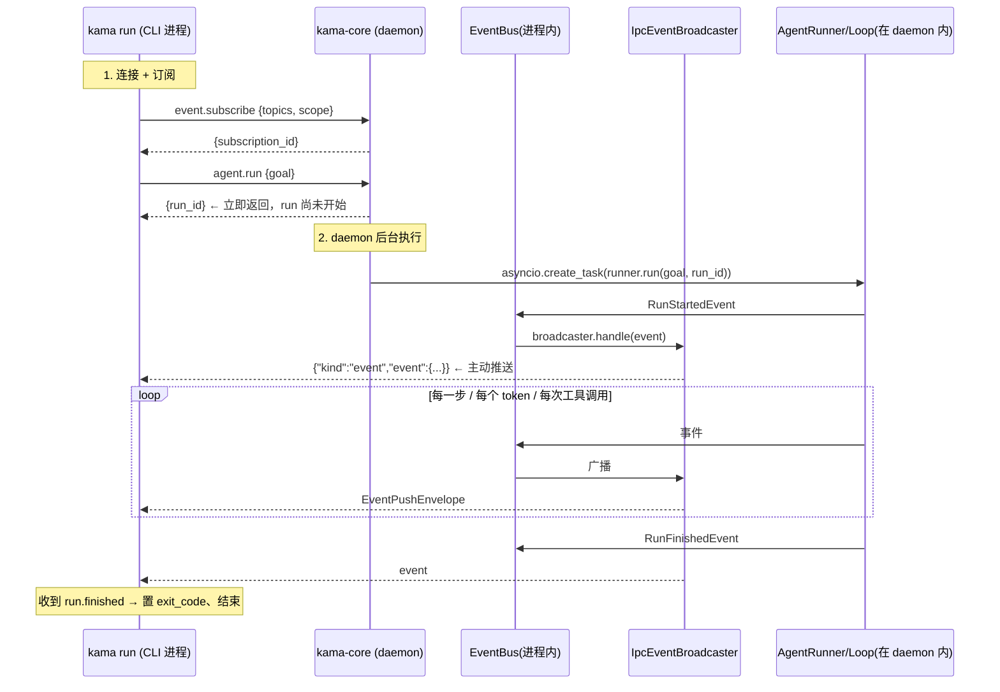

# S2 阶段 · 项目说明（把事件流外化为 IPC）

> 本文按《第 2 阶段：把事件流外化为 IPC》大纲逐节展开，对应分支 `stage/s2`，代码位置以 `src/kama_claude/` 为根。S0 的 RPC 骨架、S1 的 Agent 内环全部复用，不再重复。

---

## 1. 本阶段要做什么

S1 留下了一笔**明知的债**：Agent 跑在 CLI 进程里，事件流只是进程内的 `EventBus` 订阅——客户端一退出，一切都消失了。S2 把这笔债还掉：

> **AgentRunner 搬进守护进程，事件流从进程内总线"外化"为 IPC 广播。**

| 交付物 | 说明 |
|---|---|
| `agent.run` 命令 | daemon 接管 run 的执行，立即返回 `run_id`，后台异步执行 |
| `event.subscribe` 命令 | 客户端订阅事件流（topic 过滤 + scope 限定 + 历史回放） |
| `IpcEventBroadcaster` | 进程内 EventBus → 多客户端 TCP 广播的桥 |
| `SocketClient` | 客户端复用连接：**一条 TCP，两种消息**（RPC 响应 + 事件推送） |
| `kama core start/stop/status` | daemon 生命周期管理（后台启动 + PID 文件） |
| `kama-tui` | 真正的 TUI（Textual），实时渲染事件流、断线重连、`--replay` 回放 |

S2 之后，S0 的架构图里终于"插上了电器"：客户端可以随时开关、多开，而 Agent 运行状态只存在于 daemon——这正是 S0 双进程设计的变现时刻。

**新增依赖**：`textual>=0.75`（终端 UI 框架）。

---

## 2. 执行路径概览

一次 `kama run` 的完整路径（对比 S1：CLI 不再自己跑 Agent，而是"订阅 → 下单 → 看直播"）：



要点：**命令与结果解耦**——`agent.run` 的 RPC 响应只含 `run_id`，真正的"结果"以事件流的形式异步到达。这是从"请求-响应"到"命令-事件"的范式切换。

---

## 3. CLI 只负责发命令和消费事件

### 3.1 SocketClient：一条连接，两种消息

`core/transport/socket_client.py` 是 S0 埋下的伏笔的兑现。S0 的 `ping.py` 客户端"发一条、读一条"就完事；S2 的连接是**长连的、双向的、多路复用的**——服务器会主动推事件，客户端必须区分"这是我要的响应"还是"这是广播"：

```python
class SocketClient:
    def __init__(self, host, port):
        self._pending: dict[str, asyncio.Future] = {}   # req_id → future
        self._event_handlers: list[EventHandler] = []

    async def send_command(self, method, params) -> dict:
        req_id = str(uuid.uuid4())                       # 每条请求唯一 id
        fut = asyncio.get_running_loop().create_future()
        self._pending[req_id] = fut                      # 挂起等待
        self._writer.write((JsonRpcRequest(id=req_id, method=method, params=params)
                            .model_dump_json() + "\n").encode())
        await self._writer.drain()
        return await fut                                 # 响应由 _dispatch 唤醒
```

**分发逻辑只有两个分支**（`_dispatch`，`socket_client.py:82`）：

```python
if "jsonrpc" in msg:                       # ① JSON-RPC 响应 → 按 id 找到挂起的 future
    fut = self._pending.pop(req_id)
    if "error" in msg:
        fut.set_exception(IpcError(code, message))
    else:
        fut.set_result(msg.get("result") or {})
elif msg.get("kind") == "event":           # ② 事件推送 → 广播给所有 handler
    for handler in self._event_handlers:
        await handler(msg["event"])
```

设计要点：

- **`_pending` 字典天然支持并发 RPC**：多个请求同时 in-flight，各回各的 future——S0 文档里"响应多路分解器"就是这个东西。
- **uuid 作为请求 id**：不再手写 `"cli-1"`，多请求场景不会撞 id。
- **`run_event_loop()` 是常驻读循环**：直到连接断开（`readline()` 返回空 / OSError），finally 里取消所有挂起的 future——不会留下永远 await 的调用方。
- **协议约定**：RPC 走 `{"jsonrpc":"2.0",...}` 信封，事件走 `{"kind":"event","event":{...}}` 信封（`EventPushEnvelope`，定义在 `bus/envelope.py:15`）。**一条 TCP 连接承载两种消息，靠顶层字段区分**——这就是大纲说的"一条连接，两种消息"。

### 3.2 `kama run` 重写为消费者

`cli/commands/run.py` 里 S1 那个"组装 AgentRunner"的 `cmd_run` 没了，取而代之的是一个纯 IPC 客户端流程：

```python
async def _run_async(goal: str, config: KamaConfig) -> int:
    client = SocketClient(config.host, config.port)
    await client.connect()

    finished = asyncio.Event()
    exit_code = 0

    async def on_event(event):              # 事件消费者
        nonlocal exit_code
        await printer.handle(event)
        if event.get("type") == "run.finished":
            if event.get("status") != "success":
                exit_code = 1               # run 的成败决定 CLI 退出码
            finished.set()                  # 通知主流程收工

    client.on_event(on_event)
    loop_task = asyncio.create_task(client.run_event_loop())   # 读循环后台跑

    await client.send_command("event.subscribe", {
        "topics": ["run.*", "step.*", "tool.*", "llm.token", "llm.usage"],
        "scope": "global",
    })
    await client.send_command("agent.run", {"goal": goal})     # 下单

    await finished.wait()                   # 等 run.finished 事件

    loop_task.cancel(); await client.close()
    return exit_code
```

时序上有意**先 subscribe 再 agent.run**：保证 `run.started` 不会被漏掉。收尾用 `asyncio.Event` 等待而不是轮询。`StdoutPrinter` 原样保留（S1 的渲染逻辑、含 `_inline` 换行状态机），唯一变化是签名从"pydantic 模型"改成"dict"——**跨过 IPC 之后事件就是普通 dict**，客户端不再依赖服务端的模型类，耦合进一步降低。

另外 `exit_code` 由 `run.finished.status` 决定——shell 脚本里 `kama run ... && next` 的语义得以保留。

---

## 4. 守护进程接管 agent.run

### 4.1 `agent.run` 命令

`core/app.py` 的路由表从 1 条变成 3 条：

```python
server.register("core.ping", self._ping_handler)
server.register("agent.run", self._agent_run_handler)
server.register("event.subscribe", self._subscribe_handler)
```

`_agent_run_handler` 体现了"**命令即下单，执行在后台**"的模式：

```python
async def _agent_run_handler(self, params) -> AgentRunResult:
    cmd = AgentRunCommand.model_validate(params)

    if self._current_run_task is not None and not self._current_run_task.done():
        raise RuntimeError("a run is already in progress")   # → INTERNAL_ERROR

    run_id = new_run_id()
    runner = AgentRunner(self._config, bus=self._bus)        # ← 共享 daemon 的总线
    self._current_run_task = asyncio.create_task(
        runner.run(cmd.goal, run_id=run_id)                  # 后台执行
    )
    return AgentRunResult(run_id=run_id)                     # 立即返回
```

三个关键点：

1. **`bus=self._bus`**：`AgentRunner` 在 S2 新增了可选的 `bus` 参数（`runner.py:30,47`）——daemon 把自己的**进程内单例 EventBus** 交给 runner，于是 runner 发布的每条事件既落盘（EventWriter）又广播（broadcaster）。S1 的组装逻辑一行没改，只是换了总线来源——这是 S1 依赖注入设计的直接红利。
2. **`run_id` 由 daemon 生成并传入**（`runner.run(goal, run_id=...)`），保证 `agent.run` 的 RPC 响应里能提前给出 id，客户端可以立刻建立 scope 订阅。
3. **单 run 并发闸**：`_current_run_task` 未完成时拒绝新 run。S2 用最朴素的"同时只跑一个"守住状态一致性（多个 run 的并发调度是后续阶段的事）。

### 4.2 `event.subscribe` 命令

订阅请求需要回答一个尴尬的问题：**handler 是被连接协程调用的，它怎么知道"是哪条连接在订阅"？**

答案是 `ContextVar`（`socket_server.py:28`）——服务器在调用 handler 前把当前连接的 writer 塞进上下文：

```python
# socket_server.py:137（_handle_line 内）
_writer_var.set(writer)
try:
    result = await handler(req.params)
```

```python
# app.py:67
async def _subscribe_handler(self, params) -> EventSubscribeResult:
    cmd = EventSubscribeCommand.model_validate(params)
    writer = get_connection_writer()          # ← 拿到"调用方"的连接
    ...
    sub_id = self._broadcaster.subscribe(writer, cmd.topics, cmd.scope)
    return EventSubscribeResult(subscription_id=sub_id, replayed_count=replayed_count)
```

这比把 writer 钻透传进 handler 签名干净得多——**传输层上下文留在传输层**，handler 签名保持 `params → result` 不变（与 S0 的路由表契约完全兼容）。

订阅参数（`bus/commands.py:28`）：

```python
class EventSubscribeCommand(BaseModel):
    topics: list[str]                    # fnmatch 通配，如 ["step.*", "tool.*"]
    scope: str = "global"                # "global" | "run:<run_id>"
    replay_from_run: str | None = None   # 先回放历史，再接实时流
```

---

## 5. IPC 事件广播

`core/transport/ipc_broadcaster.py` 是"进程内总线 → N 条 TCP 连接"的桥。它本身就是一个普通的 EventBus 订阅者（daemon 启动时 `self._bus.subscribe(self._broadcaster.handle)`），对上游完全透明：

```python
@dataclass
class _Subscription:
    sub_id: str
    writer: asyncio.StreamWriter
    topics: list[str]     # fnmatch 模式
    scope: str            # "global" | "run:<run_id>"

async def handle(self, event: BaseModel) -> None:     # 每条进程内事件都会经过这里
    event_type = event_dict.get("type", "")
    run_id = event_dict.get("run_id")
    for sub in list(self._subscriptions):
        if not self._matches_topic(event_type, sub.topics):  # fnmatch 过滤
            continue
        if not self._matches_scope(run_id, sub.scope):       # global 全通 / run:<id> 精确匹配
            continue
        try:
            envelope = EventPushEnvelope(event=event_dict)
            sub.writer.write(envelope.model_dump_json().encode() + b"\n")
            await sub.writer.drain()
        except (ConnectionResetError, BrokenPipeError, OSError):
            dead.append(sub.writer)               # 死连接：标记，循环后清理
    for writer in dead:
        self.unsubscribe(writer)
```

设计细节：

- **topic 过滤用 `fnmatch`**：订阅 `["step.*", "tool.*"]` 这种通配符在服务端匹配（`_matches_topic`），而不是把所有事件都推给客户端自己过滤——省带宽，语义清晰。
- **scope 二级过滤**：`global` 收一切，`run:<run_id>` 只收指定 run——未来 daemon 多 run 并发时，不同客户端各看各的。
- **死连接延迟清理**：写失败不立刻改订阅表（正在迭代中），先收集、循环结束后统一 `unsubscribe`；同时 `_handle_connection` 的 finally 也会兜底清理（`socket_server.py:88-89`）。**断线不会让广播阻塞或崩溃**。
- **广播是逐个 `await drain`**：一个慢客户端会让整条发布路径等它（背压直接传导）。S2 客户端少、流量小，正确性优先；多 run + 慢消费者场景出现时需要每订阅一个写队列（见 §9）。

---

## 6. 事件回放

`events.jsonl`（S1 起每次 run 都落盘）在 S2 有了第二个读者。订阅时带上 `replay_from_run`，服务端先**从磁盘重放历史**，再注册实时订阅（`app.py:81-108`）：

```python
async def _replay_events(self, run_id, writer, topics) -> int:
    path = events_file(run_id)
    if not path.exists():
        return 0
    count = 0
    for line in path.read_text().splitlines():
        event = json.loads(line)                  # 坏行跳过，不中断回放
        if not any(fnmatch.fnmatch(event.get("type", ""), p) for p in topics):
            continue                              # 同一套 topic 过滤规则
        writer.write(EventPushEnvelope(event=event).model_dump_json().encode() + b"\n")
        count += 1
    if count:
        await writer.drain()
    return count
```

三个刻意的设计：

1. **历史与实时走同一种信封**：回放的行被包进 `EventPushEnvelope` 再发——客户端**不区分**"这是刚发生的"还是"这是过去发生的"，消费逻辑零特判。
2. **先回放后订阅**：`_subscribe_handler` 里先 `_replay_events` 再 `broadcaster.subscribe`，保证客户端看到的事件顺序是"历史 → 实时"单调递增，不会乱序。
3. **响应里带 `replayed_count`**：订阅结果 `EventSubscribeResult(subscription_id, replayed_count)` 让客户端知道自己补了多少历史（TUI 和集成测试都靠它验证回放生效）。

这就是"事件溯源"的轻量版：**磁盘上的 JSONL 就是事实记录，连接只是它的一个视图**。客户端崩溃重启后，凭 `run_id` 重连 + 回放即可无损恢复现场（TUI 的 `--replay RUN_ID` 就是干这个的）。

---

## 7. TUI 客户端

`kama-tui`（Textual 框架）是事件流的第二个消费者——也是"多客户端订阅"的第一个证明：CLI 和 TUI 可以**同时**连着 daemon 看同一场 run。

`src/kama_claude/tui/app.py` 的结构：

```python
class KamaTuiApp(App[None]):
    def compose(self):                      # 两块 UI
        yield Label("● connecting...", id="status")   # 顶部状态栏
        yield RichLog(id="log")                       # 可滚动事件日志

    def on_mount(self):
        self.run_worker(self._socket_loop(), exclusive=True)  # socket 循环放进 worker
```

### 7.1 断线自动重连

`_socket_loop` 是一个 `while True`——连接失败或中断后 2 秒重试，状态栏实时反映：

```python
while True:
    client = SocketClient(self._host, self._port)
    try:
        await client.connect()
    except (ConnectionRefusedError, OSError):
        status.update("● not connected — retrying in 2s")
        await asyncio.sleep(2)
        continue
    ...
    finally:
        self._flush_tokens(log); await client.close()
    status.update("● disconnected — retrying in 2s")
```

daemon 重启、网络抖动，TUI 都能自愈——这是"客户端无状态、daemon 持有状态"架构的直接受益者。

### 7.2 token 缓冲

TUI 与 `StdoutPrinter` 的一个关键差异：`RichLog.write()` 是**按行**追加的，不能像 `print(end="")` 那样流式打半行。所以 `llm.token` 先攒进缓冲区，遇到其他事件（或断线）时整体 flush：

```python
if t == "llm.token":
    self._token_buf += event.get("token", "")
    return
self._flush_tokens(log)      # 任何别的事件到来前，先把攒的 token 写出去
```

### 7.3 渲染与回放

- 事件 → Rich 标记的彩色行：run 蓝色▶、工具绿色/红色、usage/log 灰色 dim。
- 订阅 topics 比 CLI 多两个：`llm.usage`、`log.*`（TUI 是"看一切"的监控视角，CLI 只关心自己那次 run）。
- `--replay RUN_ID`（`tui/__main__.py`）把 `replay_from_run` 传给订阅命令——启动即回放历史 run，实现"事后复盘"。

### 7.4 daemon 生命周期：`kama core start/stop/status`

配套的 `cli/commands/core.py` 让 daemon 不再需要手工开终端：

- `status`：TCP 探活，输出 `running (host:port)` / `not running`。
- `start`：先探活防重复；用 `subprocess.Popen([sys.executable, "-m", "kama_claude.core"], start_new_session=True, ...)` 脱离终端后台启动，PID 写入 `~/.kama/kama-core.pid`。
- `stop`：读 PID 文件 → `os.kill(pid, SIGTERM)` → daemon 的信号处理（S0 建立的优雅退出）触发 `server.stop()`。`os.kill(pid, 0)` 探活，僵尸 PID 文件自动清除。

---

## 8. 验证

### 8.1 单元测试

S2 新增 5 个单测文件，覆盖每个新组件：

| 文件 | 覆盖点 |
|---|---|
| `test_socket_client.py` | 两种消息分发、pending future 唤醒、断连时 future 全部取消 |
| `test_ipc_broadcaster.py` | topic fnmatch 过滤、scope 过滤、扇出、死连接清理 |
| `test_socket_server.py` | ContextVar 注入 writer、连接关闭时自动退订 |
| `test_stdout_printer.py` | 各事件的终端渲染（含 `_inline` 换行） |
| `test_tui_app.py` | TUI 事件渲染与 token 缓冲逻辑 |
| `test_commands_events.py` | 新命令/事件模型的校验（判别联合扩展） |

### 8.2 集成测试

`tests/integration/test_s2_dual_process.py` 是 S2 的验收核心——**真实拉起 daemon 子进程、走完整 IPC 链路**（conftest 提供 `running_daemon` / `free_port` fixture）：

1. **`test_agent_run_returns_run_id_and_emits_started`**：`agent.run` 返回非空 `run_id`，随后同一 `run_id` 的 `run.started` 事件到达——验证"命令即下单 + 事件回传"闭环。妙处在于 `run.started` 在 LLM 调用**之前**发布，所以**不需要 API Key**。
2. **`test_two_clients_both_receive_broadcast`**：两个客户端都订阅 `run.*`，一个触发 run，`asyncio.gather` 等两方都收到——验证 broadcaster 的扇出语义。
3. **`test_disconnect_and_replay_from_run`**：客户端 1 触发 run 拿到 `run_id` 后断开；客户端 2 用 `replay_from_run` 重连订阅，断言 `replayed_count > 0`——验证磁盘回放链路。

```bash
uv run pytest tests/unit -v                        # 无网络依赖
uv run pytest tests/integration/test_s2_dual_process.py -v
```

### 8.3 手动验证

```bash
# 1. daemon 生命周期
uv run kama core status        # → not running
uv run kama core start         # → started pid=12345 (127.0.0.1:7437)
uv run kama core status        # → running (127.0.0.1:7437)

# 2. IPC 化的 run（此时 Agent 在 daemon 里跑，CLI 只是看直播）
uv run kama run --goal "读取 README.md 并总结前 10 行"

# 3. run 期间另开终端：第二个消费者看到同一场直播
uv run kama-tui                # 实时彩色事件流；q 退出

# 4. 事后回放
uv run kama-tui --replay <run_id>      # 启动即重放历史事件

# 5. 收尾
uv run kama core stop          # → stopped pid=12345
```

---

## 9. 小结与展望

### S2 立住了什么

| 组件 | 位置 | 一句话职责 |
|---|---|---|
| `SocketClient` | `core/transport/socket_client.py` | 客户端多路复用：一条连接、两种消息、并发 RPC |
| `IpcEventBroadcaster` | `core/transport/ipc_broadcaster.py` | 进程内事件 → 多客户端广播（topic/scope 过滤、死连接清理） |
| `EventPushEnvelope` | `core/bus/envelope.py` | 事件推送的第二种信封（与 JSON-RPC 并存） |
| `agent.run` / `event.subscribe` | `core/app.py`、`core/bus/commands.py` | daemon 的两条新路由；ContextVar 传递连接上下文 |
| `kama core start/stop/status` | `cli/commands/core.py` | daemon 生命周期（Popen + PID 文件 + SIGTERM） |
| `KamaTuiApp` | `tui/app.py` | Textual TUI：实时渲染、断线重连、token 缓冲、回放 |

**S2 完成的架构闭环**：S0 修的"电线"终于通上了 S1 造的"电器"。职责分布变成——

- **daemon**：配置、日志、Agent 执行、事件落盘、事件广播（全部有状态的部分）；
- **CLI / TUI**：连接、订阅、渲染（全部无状态的部分），**随时开关、可多开、崩溃即重连**。

从 S1 到 S2 的质变：事件从"进程内函数调用"（`bus.publish → await handler`）变成"跨进程消息"（`bus.publish → broadcaster → TCP → 客户端 handler`）。消费者与生产者不再共生死——CLI 退出，run 照跑；CLI 重启，回放补课。

### 已知的边界（S2 有意为之）

- **单 run 并发闸**：`_current_run_task` 同时只允许一个 run，多 run 调度留给后续阶段。
- **广播无写队列**：`handle()` 里逐个 `await drain`，慢客户端会拖慢整条发布路径；每订阅一个 `asyncio.Queue` + 独立写任务是多 run 时代的前置改造。
- **回放与订阅之间的微小窗口**：回放读文件与注册实时订阅之间，正在进行的 run 若恰好发布事件，理论上存在漏接/重复的可能（单机低频场景可接受）。
- **`os.kill(pid, SIGTERM)` 在 Windows 上语义受限**（近似 `TerminateProcess`，daemon 的优雅退出路径走不到）——与 S0 记录的平台差异同源。
- `ping.py` 仍是 S0 的"一次性连接"实现，未迁移到 `SocketClient`（功能正确，属可接受的债务）。

### 后续阶段怎么盖楼

- **S3+（多 run 与会话）**：去掉单 run 闸 → run 注册表 + `scope: "run:<id>"` 真正派上用场；`agent.run` 可加 `run_id` 幂等键。
- **订阅增强**：`unsubscribe` 命令、订阅游标（回放位点续传）、每订阅写队列。
- **TUI 交互**：目前是只读监控；接入 `agent.cancel` 之类的控制命令后成为操作台。
- **协议文档**：新命令与 `EventPushEnvelope` 已随 `gen_protocol_doc.py` 的模型清单同步进 `WIRE_PROTOCOL.md`（`--check` 把关）。
