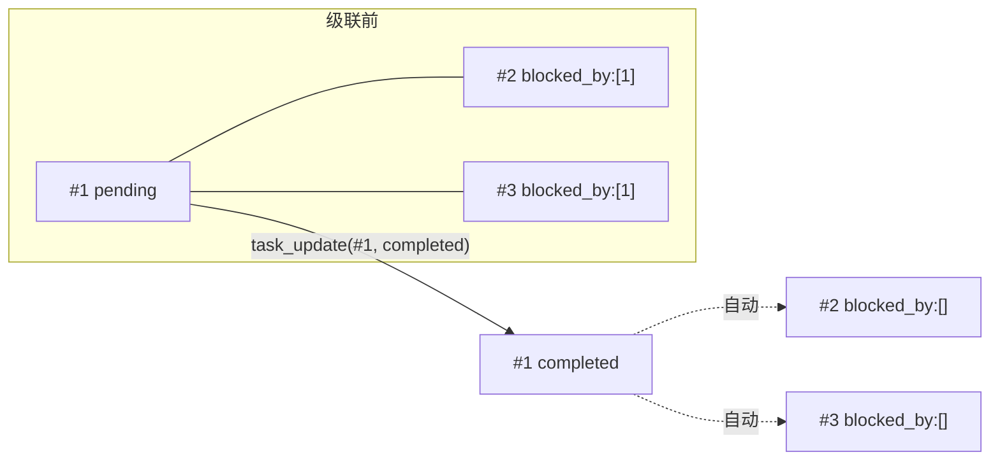
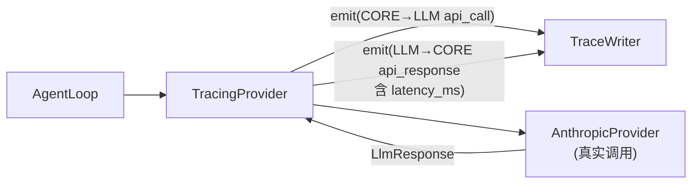

# S3 阶段 · 项目说明（Agent 的自主规划与终端可视化）

> 本文按《第 3 阶段：Agent 的自主规划与终端可...》大纲逐节展开，对应分支 `stage/s3`，代码位置以 `src/kama_claude/` 为根。S0–S2 的 IPC 骨架、Agent 内环、事件广播全部复用，不再重复。

---

## 1. 本阶段要做什么

S1/S2 的 Agent 只会"闷头干活"——给一个 goal，LLM 一步步做到底。S3 给它两样东西：

1. **自主规划能力**：工具集扩到 8 个（含 4 个任务管理工具），Agent 可以把复杂目标拆解成带 `blocked_by` 依赖的任务图、逐个推进、自主跟踪进度。
2. **终端可视化**：TUI 从"文本行日志"升级为"单列滚动流"——LLM 回答原地累积、工具调用块可点击折叠/展开。

| 交付物 | 说明 |
|---|---|
| `TaskManager` + `Task` 模型 | 同步文件 CRUD（每任务一个 JSON），`blocked_by` 自动级联清理 |
| 工具集 1 → 8 | `read_file` / `bash` / `write_file` / `list_dir` + `task_create` / `task_get` / `task_list` / `task_update` |
| 多 run 并发 | S2 的单 run 闸撤除，daemon 用 `_running_runs` 集合并发托管任意多个 run |
| 追踪层（trace） | `TracingProvider` 装饰器 + 异步队列 `TraceWriter` + `kama trace` 查看命令 |
| TUI 改版 | 单列滚动流：LLM 流式原地累积、工具块折叠展开、步骤分隔线 |
| 小增强 | `ToolCallFinishedEvent` 携带 `output`；`context.result` 记录最终回答；`RunOutcome` |

---

## 2. 守护进程启动 run

S2 的 `_agent_run_handler` 有一把单 run 闸（`_current_run_task` 未完成就拒绝），S3 撤掉了它——daemon 现在可以**同时托管任意多个 run**：

```python
# app.py（S3）
class CoreApp:
    def __init__(self):
        ...
        self._running_runs: set[asyncio.Task[None]] = set()

    async def _agent_run_handler(self, params) -> AgentRunResult:
        cmd = AgentRunCommand.model_validate(params)
        run_id = new_run_id()
        runner = AgentRunner(self._config, bus=self._bus, trace=self._trace)
        run_task = asyncio.create_task(runner.run(cmd.goal, run_id=run_id))
        self._running_runs.add(run_task)
        run_task.add_done_callback(self._running_runs.discard)   # 结束自动移出
        return AgentRunResult(run_id=run_id)
```

配套改动是**优雅关闭的升级**（S2 只有一个 task 要取消，S3 是一批）：

```python
for run_task in list(self._running_runs):
    run_task.cancel()                       # 全部取消
if self._running_runs:
    await asyncio.gather(*self._running_runs, return_exceptions=True)  # 等它们落地
await server.stop()
if self._trace is not None:
    await self._trace.stop()
```

`set + done_callback` 的模式比 S2 的单引用健壮：run 结束自动出集合（不泄漏），shutdown 时精确取消所有在跑的 run。每个 run 创建时带上 `trace=self._trace`——这是追踪层（§7）的入口。

---

## 3. AgentRunner 接入 TaskManager

`runner.py` 的装配逻辑新增了任务系统和追踪两个环节：

```python
async def run_and_capture(self, goal, *, run_id=None) -> RunOutcome:
    run_path = self._runs_dir / run_id
    task_manager = TaskManager(run_path / ".tasks")     # ① 每次 run 一个独立任务目录

    provider = self._provider or AnthropicProvider(...)
    if self._trace is not None:                         # ② 装饰器包裹 provider
        provider = TracingProvider(provider, self._trace,
                                   include_payload=self._config.trace.include_llm_payload)
    registry = self._build_registry(task_manager)       # ③ 8 个工具，任务工具共享同一 manager
    loop = AgentLoop(provider, registry, bus)
```

三个关键决策：

1. **任务文件放在 `runs/<run_id>/.tasks/`**：任务图是**单次 run 的私有状态**，随 run 目录一起留档（和 `events.jsonl` 并排）。不同 run 之间互不污染；事后翻 run 目录能同时看到"发生了什么"（事件）和"当时怎么规划的"（任务）。
2. **共享同一个 `TaskManager` 实例**：4 个任务工具由 `_build_registry` 统一注入同一个 manager——Agent 第 1 步 `task_create` 建的任务，第 5 步 `task_list` 一定看得到。
3. **`run()` 委托给 `run_and_capture()`**：新增返回值 `RunOutcome(status, result, reason)`，其中 `result` 是 LLM 最后一次 `end_turn` 的文本——`loop.py` 在成功时把它写进 `context.result`：

```python
# loop.py（S3 新增两处）
response = await self._provider.chat(..., step=context.step)   # ① 透传步号（trace 关联用）
...
if response.stop_reason == "end_turn":
    context.result = response.text or ""                        # ② 记录最终回答
    context.mark_success()
```

`step` 参数让追踪层能把每次 LLM 调用关联回具体步骤（`TraceRecord.step`），`LLMProvider` Protocol 相应加了 `step: int = 0` 关键字参数——带默认值，向前兼容旧实现。

---

## 4. TaskManager：同步的文件 CRUD

`core/task/` 两个文件：`model.py`（dataclass）+ `manager.py`（存储）。

### 4.1 模型与存储格式

```python
TaskStatus = Literal["pending", "in_progress", "completed"]

@dataclass
class Task:
    id: int
    subject: str
    description: str
    status: TaskStatus
    blocked_by: list[int]        # 依赖：哪些任务完成后本任务才能做
    created_at: str
    updated_at: str
```

**每任务一个 JSON 文件**（`tasks_dir/task_<id>.json`），不用数据库、不用单一大文件：

```python
class TaskManager:
    def __init__(self, tasks_dir: Path) -> None:
        self._dir.mkdir(parents=True, exist_ok=True)
        self._next_id = self._max_id() + 1     # 扫描现有文件确定下一个 ID（重启不重号）

    def create(self, subject, description="", blocked_by=None) -> Task:
        for dep_id in (blocked_by or []):      # 引用完整性：依赖的任务必须存在
            if not (self._dir / f"task_{dep_id}.json").exists():
                raise ValueError(f"blocked_by task {dep_id} not found")
        ...
    def update(self, task_id, *, status=None, add_blocked_by=None,
               remove_blocked_by=None) -> Task: ...
    def list_all(self) -> list[Task]: ...      # glob + 按 ID 排序；坏文件跳过
```

**为什么是同步 I/O 而不是 asyncio 文件读写？** 有意的取舍：任务文件只有几百字节，本地写入是微秒级，阻塞事件循环的开销可忽略；换来代码完全同步、无锁、无竞态——每个 run 的 `tasks_dir` 私有，且 asyncio 单线程内不会并发进入这些方法。对比之下，`TraceWriter`（高频、可能大 payload）就用了异步队列（§7）——**按 I/O 特征选同步/异步**，而不是一刀切。

### 4.2 `blocked_by` 的自动级联

任务图的正确性靠一条规则维持：**任务完成时，自动把自己从所有其他任务的 `blocked_by` 里摘除**。

```python
def update(self, task_id, *, status=None, ...):
    task = self._load(task_id)
    if status == "completed":
        self._clear_dependency(task_id)        # ← 级联就发生在这一行

def _clear_dependency(self, completed_id: int) -> None:
    for f in self._dir.glob("task_*.json"):    # 扫全目录
        blocked = [int(x) for x in data.get("blocked_by", [])]
        if completed_id in blocked:
            data["blocked_by"] = [x for x in blocked if x != completed_id]
            data["updated_at"] = _now()
            f.write_text(...)                  # 原子改写该文件
```

为什么这条规则重要：Agent 的工作流是"`task_list` 看还有什么可做 → 挑一个没被阻塞的做"。如果完成 A 后 B 的 `blocked_by` 还挂着 A，看列表就会误判 B 仍不可做。级联清理让 **`blocked_by` 永远只包含"真正还未完成"的依赖**，列表即真相。



另外 `update` 支持 `add_blocked_by` / `remove_blocked_by`（集合去重），Agent 可在执行中动态补依赖。

---

## 5. 工具集扩展到 8 个

`runner._build_registry` 注册的完整清单：

| 工具 | 类型 | 防护要点 |
|---|---|---|
| `read_file` | 文件 | 禁 `..` 穿越；512KB 截断 |
| `write_file` | 文件 | 禁 `..` 穿越；1MB 上限；自动建父目录 |
| `list_dir` | 文件 | 目录列举 |
| `bash` | 执行 | 64KB 输出截断；timeout 默认 60s 上限 120s；非零退出码 → `is_error` |
| `task_create` | 任务 | 依赖必须存在；返回任务 JSON |
| `task_get` | 任务 | 单任务查询 |
| `task_list` | 任务 | `format_list()` 人类可读摘要 |
| `task_update` | 任务 | 状态迁移 + 依赖增删；completed 触发级联 |

新工具的共性写法——**任务工具是 TaskManager 的薄包装**：

```python
class TaskCreateTool(BaseTool):
    name = "task_create"
    def __init__(self, task_manager: TaskManager) -> None:   # 构造注入共享实例
        self._manager = task_manager

    async def invoke(self, params) -> ToolResult:
        try:
            task = self._manager.create(subject, description, blocked_by)
            return ToolResult(content=json.dumps(task.to_dict(), ensure_ascii=False))
        except ValueError as exc:                             # 业务错误 → is_error 结果
            return ToolResult(content=str(exc), is_error=True, error_type="runtime_error")
```

延续 S1 的分层：`invoke_tool` 的四道闸（存在性/参数/超时/异常）对 8 个工具一律生效，任务工具只需处理"业务级"错误（如依赖不存在）。

`bash` 是能力最大也最危险的工具，防护三层递进：

```python
proc = await asyncio.create_subprocess_shell(command, stdout=PIPE, stderr=STDOUT)  # 合并输出
stdout_bytes, _ = await asyncio.wait_for(proc.communicate(), timeout=timeout)       # ① 时间闸
# 超时 → proc.kill() + "[timeout after Ns]" 错误结果
# ② 输出闸：64KB 截断 + [truncated]
# ③ 退出码闸：returncode != 0 → "[exit N]\n..." + is_error=True
```

---

## 6. LLM 拿到任务工具之后

工具 schema 本身就是**给 LLM 的行为脚本**——4 个任务工具的 description 连起来读就是一个规划工作流：

- `task_create`："Use this to **break down a complex goal into smaller, trackable steps**."
- `task_update`："Set status to **'in_progress' when starting work**, **'completed' when finished**..."

S3 没有写任何"规划引擎"，规划行为完全由 LLM 通过工具调用涌现。一条典型轨迹：

```
step 1: task_create #1 "读取配置文件"
        task_create #2 "解析字段" blocked_by:[1]
        task_create #3 "生成报告" blocked_by:[2]
step 2: task_list            → [ ] #1 ... / [ ] #2 (blocked by: [1]) ...
step 3: task_update #1 in_progress → 干活 → task_update #1 completed（级联解锁 #2）
step 4: task_list → #2 已解除阻塞 → 继续……
```

反馈闭环由 `format_list()` 保证——返回的不是 JSON 而是**人和模型都易读的摘要**：

```
[ ] #1: 读取配置文件
[>] #2: 解析字段 (blocked by: [1])
[x] #3: 生成报告
```

`[ ]`/`[>]`/`[x]` 状态标记 + `(blocked by: ...)` 后缀，让 Agent 每次 `task_list` 只花几十个 token 就重建全局规划视图——比回传全部任务 JSON 便宜得多。

---

## 7. 追踪层：给整条链路留痕

（大纲截图未完全展开，此处按代码补记。）S3 新增 `core/trace/`，目标：**把 IPC、事件、LLM 三个层面的流量全部落成 JSONL，事后可查**。

### 7.1 装饰器模式：TracingProvider

追踪不改一行业务代码——`TracingProvider` 实现 `LLMProvider` 同款接口，把真实 provider 包在中间：



```python
async def chat(self, messages, tool_schemas, bus, run_id, *, step=0) -> LlmResponse:
    self._trace.emit(TraceRecord(direction="CORE→LLM", layer="llm",
                                 kind="api_call", run_id=run_id, step=step, data=call_data))
    t0 = time.monotonic()
    result = await self._inner.chat(...)
    self._trace.emit(TraceRecord(direction="LLM→CORE", layer="llm",
                                 kind="api_response", data={..., "latency_ms": ...}))
    return result
```

`include_payload` 开关控制记录体积：`True` 存完整 messages/tool_schemas（可回放对话），`False` 只存 `message_count`/`tool_count` 摘要——调试时开、长期运行关。

### 7.2 异步队列写入：TraceWriter

LLM payload 可能很大，绝不能在调用路径上同步写盘。`TraceWriter` 用**队列 + 后台 drain task**：

```python
def emit(self, record: TraceRecord) -> None:      # 非阻塞：put_nowait
    self._queue.put_nowait(record)

async def _drain(self) -> None:                   # 后台任务逐条落盘
    with open(self._path, "a") as f:
        while True:
            record = await self._queue.get()
            f.write(record.model_dump_json() + "\n"); f.flush()
            self._queue.task_done()

async def stop(self) -> None:
    await self._queue.join()                      # ← 先等队列清空，再取消任务
```

`stop()` 先 `join()` 再 `cancel()` 的顺序保证**退出时不丢最后几条记录**——这是关闭异步写者的标准姿势。

### 7.3 记录模型与查看命令

`TraceRecord` 用 `direction × layer` 二维定位流量：

| direction | layer | 谁记录 |
|---|---|---|
| `CLIENT→CORE` / `CORE→CLIENT` | ipc | SocketServer（构造时注入 trace） |
| `CORE` | event | `CoreApp._trace_event_handler`（EventBus 订阅者） |
| `CORE→LLM` / `LLM→CORE` | llm | `TracingProvider` |

注意 EventBus 侧的接法：trace 是 **EventBus 的又一个订阅者**，与 broadcaster、EventWriter 并排——S1 建立的"事件驱动解耦"让新观测点零侵入接入。

查看端是 `kama trace` 子命令（`cli/commands/trace.py`）：按 `--run` / `--layer` / `--direction` 过滤，`--raw` 输出原始 JSON，`--follow` 类似 `tail -f` 实时跟看；ANSI 按 direction 着 5 色。

配置新增 `[trace]` 节：`enabled`（默认 true）、`file`（默认 `~/.kama/traces/daemon.jsonl`）、`include_llm_payload`（默认 true），`KAMA_TRACE_*` 环境变量可覆盖——延续 S0 的四层配置模式。

---

## 8. TUI 改版：单列终端滚动流

### 8.1 从 RichLog 到 widget 流

S2 的 TUI 是一个 `RichLog`（只能整行追加文本）；S3 换成 **`VerticalScroll` 里动态挂载 widget**：

```python
def compose(self) -> ComposeResult:
    yield Label("...", id="header")
    yield VerticalScroll(id="log-view")

def _append(self, widget: Widget) -> None:          # 唯一的挂载入口
    log_view.mount(widget)
    log_view.scroll_end(animate=False)              # 永远滚到底，像终端滚屏
```

事件 → widget 的映射（单列自上而下）：

| 事件 | 渲染 |
|---|---|
| `run.started` | 青色 `▶ run <id>` + goal |
| `step.started` | 灰色分隔线 `── step N ────` |
| `llm.token` | → 流式文本块（§8.2） |
| `tool.call_started/finished/failed` | → 可折叠工具块（§8.3） |
| `run.finished` | 绿 `✓ completed` / 红 `✗ failed <reason>` |
| `llm.usage` / `log.line` | dim 小字 |

### 8.2 LLM 流式输出的原地累积

S2 的做法是"token 攒进字符串缓冲、遇其他事件整体 flush"；S3 改成**真正的原地更新**——一个 widget 就是 LLM 的一段完整回答，token 来一个 `update()` 一次：

```python
class LLMStreamBlock(Static):
    def append_token(self, token: str) -> None:
        self._text += token
        self.update(self._text)            # ← 就地重绘同一个 widget
```

TUI 侧用一个指针跟踪"当前正在流入的块"：

```python
if t == "llm.token":
    if self._current_llm is None:          # 没有开放块 → 新建一个
        llm_block = LLMStreamBlock()
        self._append(llm_block)
        self._current_llm = llm_block
    self._current_llm.append_token(token)
    return

self._break_llm()                          # 任何其他事件到来 → 结束当前块
```

`_break_llm()` 只做 `self._current_llm = None`——下一个 token 自然开启新块。于是"LLM 说话 → 工具调用 → LLM 接着说"在屏幕上是**三个独立的块**，而不是混成一团。

### 8.3 工具调用块的折叠展开

`ToolCallBlock` 是 S3 TUI 交互性最强的部分——**默认折叠成摘要，点击展开完整 params/output**：

```python
class ToolCallBlock(Widget):
    DEFAULT_CSS = """
    ToolCallBlock > .detail { display: none; }              # 折叠态：细节隐藏
    ToolCallBlock.expanded > .detail { display: block; }    # 展开态：细节显示
    """

    def compose(self):
        yield Static(self._summary(), classes="summary")    # 一行摘要
        yield Static("", classes="detail")                  # 展开后的全文

    def set_result(self, output, elapsed_ms, *, is_error=False):
        ...
        self.query_one(".summary", Static).update(self._summary())   # 完成时回填摘要

    def on_click(self) -> None:                             # 点击切换
        if "expanded" in self.classes:
            self.remove_class("expanded")
        else:
            detail.update(f"params:\n {...}\noutput:\n {...}")
            self.add_class("expanded")
```

两个工程细节：

1. **用 `tool_use_id` 配对 started/finished**：`_pending_tool_blocks: dict[str, ToolCallBlock]` 以 `tool_use_id` 为键，`tool.call_finished` 到达时找到对应的块回填结果（`set_result`）。这依赖本阶段的一个协议小扩展——`ToolCallFinishedEvent` 新增了 `output: str` 字段（`events.py`），工具结果得以流到 TUI。
2. **防御未挂载的 DOM 更新**：`set_result` 里 `if self.children:` 才刷新——事件乱序或 widget 尚未 mount 时不会抛异常。

摘要行也是精心设计的：工具名加粗、params 截断 60 字符、完成后追加 `↳ output 预览 + 耗时`，只有 output 超过 50 字符才显示 `▸ click to expand` 提示——折叠态永远只有两行。

---

## 9. 验证

### 9.1 单元测试

S3 新增/更新的单测：

| 文件 | 覆盖点 |
|---|---|
| `test_task_model.py` | Task 的 to_dict/from_dict 往返、默认值容错 |
| `test_task_manager.py` | CRUD、ID 自增、依赖不存在报错、**completed 级联清理**、list 排序 |
| `test_builtin_tools.py` | bash/write_file/list_dir 的截断、超时、退出码、路径穿越防护 |
| `test_tracing_provider.py` | 装饰器记录 CORE→LLM/LLM→CORE、payload 开关、latency 计算 |
| `test_trace_writer.py` | 队列写入、stop 时 join 清空不丢记录 |
| `test_tui_app.py` | 大改：块的原地累积、tool_use_id 配对、折叠展开 |

### 9.2 集成测试

`tests/integration/test_s3_task_graph.py` 意图是走真实 daemon 验证任务图。**需要注意**：该测试写的是 wire 层的 `task.create`/`task.list` 命令（含 `parent_id`、错误码 `-32003 TASK_NOT_FOUND`），但当前 `app.py` 只注册了 `core.ping` / `agent.run` / `event.subscribe` 三条路由——任务操作实际是以**工具**（`task_create` 等，经 `agent.run` 内部执行）实现的，不是独立 RPC 端点。这份测试与最终实现存在偏差（更接近早期设计稿），运行会得到 `METHOD_NOT_FOUND`。这是"计划文档驱动开发"过程中的产物——**文档/测试先于实现、实现时改走了工具路线**。以实现为准，此测试需重写为"经 `agent.run` 触发任务工具"的形式。

可靠的验证路径是既有的 `test_runner.py`（新增 4 行断言任务注册表）与 `test_loop.py`（`step` 参数透传），外加手动验证：

### 9.3 手动验证

```bash
uv run kama core start

# 1. 观察自主规划：goal 给复杂一点，看 Agent 是否拆任务
uv run kama run --goal "读取 README.md，总结成 3 条要点写入 summary.md"
# 终端应看到 task_create/task_list/task_update 调用流

# 2. TUI 看可视化（run 进行中或之后另开终端）
uv run kama-tui
# 单列滚动流；点击工具块展开 params/output；q 退出

# 3. 回放历史 run
uv run kama-tui --replay <run_id>

# 4. 翻 run 档案：事件 + 任务图并排
cat runs/<run_id>/events.jsonl
cat runs/<run_id>/.tasks/task_1.json

# 5. 追踪：全程留痕 + 实时跟看
uv run kama trace --layer llm --follow
uv run kama trace --run <run_id> --direction CORE→LLM
```

---

## 10. 小结与展望

### S3 立住了什么

| 组件 | 位置 | 一句话职责 |
|---|---|---|
| `Task` / `TaskManager` | `core/task/` | 单 run 私有的任务图；文件 CRUD + completed 级联 |
| 8 个内置工具 | `core/tools/builtin/` | 文件/执行/任务四件套；同一套四道闸防护 |
| 多 run 托管 | `core/app.py` | `_running_runs` 集合 + 批量取消的优雅关闭 |
| `TracingProvider` | `core/trace/provider.py` | 装饰器式 LLM 流量留痕（含 payload 开关） |
| `TraceWriter` | `core/trace/writer.py` | 异步队列落盘，退出不丢尾 |
| `kama trace` | `cli/commands/trace.py` | 过滤/着色/follow 的追踪查看器 |
| TUI 单列滚动流 | `tui/app.py` | widget 流：原地累积 LLM 文本、可折叠工具块 |

从 S2 到 S3 的质变：Agent 从"单线程执行者"变成"**自我管理的项目执行者**"——它维护一张自己创建、自己消费的任务图，且这套规划对用户是**可见的**（TUI）**、可追溯的**（trace + `.tasks/` 档案）。观测面也完成了三级跳：日志（S0）→ 事件流（S1/S2）→ 全链路 trace（S3）。

### 已知的边界

- **集成测试与实现偏差**：`test_s3_task_graph.py` 假设 wire 层有 `task.*` 命令，与工具式实现不符，需重写（§9.2）。
- **任务无持久生命周期**：任务图随 run 目录存档，但没有跨 run 的任务列表/历史查询命令。
- **bash 无沙箱**：只有时间/输出/退出码三闸，命令本身在 daemon 权限下任意执行——单机自用可接受，多租户前必须隔离。
- **级联是全目录扫描**：`_clear_dependency` 每次完成都 glob 全部任务文件；任务数上千时需要索引。
- **trace 无轮转**：daemon.jsonl 追加不滚动，长期运行需配合 `include_llm_payload=false` 或外部清理。

### 后续阶段怎么盖楼

- **S4（模型路由 rule_based）**：`LlmModelSelectedEvent.strategy` 已预留；`TracingProvider` 的记录里将出现非 static 策略。
- **跨 run 任务**：`TaskManager` 上移到 daemon 级（而不是 per-run），任务图成为 daemon 的持久状态，配合 `scope: run:<id>` 的订阅让客户端只看自己 run 的任务事件。
- **TUI 交互闭环**：折叠展开之后，下一步是命令输入（提交 run / 取消 run），TUI 从监控台变操作台。
- **trace 可视化**：JSONL → 火焰图/时间线视图，`direction × layer` 的二维模型正好按泳道展开。
